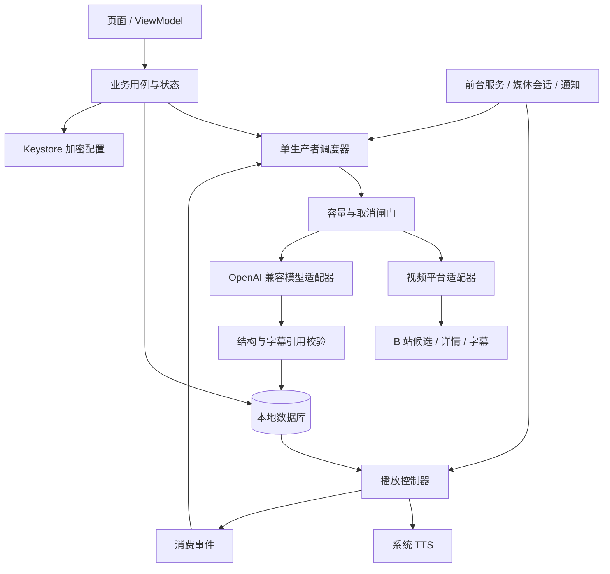

# 拾知：产品与技术设计草案 v0.5

日期：2026-11-03（Asia/Shanghai）
状态：用户确认继续后，已进入 Android 验证版实施。正式技术目标仍见第 5 节；本阶段采用 Java 原生能力 + 本地界面验证闭环，详见 IMPLEMENTATION.md。APK 已编译和签名，真机接入尚未验收。

## 1. 已确认的产品约束

- 手机独立运行，直接调用用户填写的 OpenAI 兼容 URL / Key，不需要电脑或自建后端。
- 底部主导航：**刷视频、设置**；未来独立功能增加新的主入口。
- 刷视频内的子分页：**待听、历史、收藏、功能设置**。历史和收藏不是应用级入口。
- 平台当前只支持 B 站，保留平台适配器扩展能力。
- 由用户填写兴趣，筛选视频、提炼有用内容、TTS 播报；可以上一条、下一条、暂停和收藏。
- 待播上限默认 3 条，可在刷视频的功能设置里调整。
- 普通历史保留 7 天；收藏不随历史清理。
- **不设置「每轮请求上限」或强制重开一轮。正常持续听，就持续按需补货。**
- 先确认架构和界面，再做真实接入与安装包。

## 2. 信息架构

```text
底部主导航
├─ 刷视频
│  ├─ 待听
│  │  ├─ 平台入口：B 站
│  │  ├─ 重新刷视频 / 暂停刷取 / 继续刷取
│  │  ├─ 当前播报、上一条 / 播放暂停 / 下一条 / 收藏
│  │  ├─ 内容详情、知识点、字幕引用、原视频入口
│  │  └─ 待播列表与当前生产状态
│  ├─ 历史（7 天）
│  ├─ 收藏（长期）
│  └─ 功能设置
│     ├─ 待播上限（默认 3；范围暂拟 1–10）
│     ├─ 兴趣、学习目标、屏蔽关键词
│     ├─ 自动连播、语速、TTS 测试
│     ├─ B 站登录 / 退出
│     └─ 高级：字幕处理方式等
└─ 设置（全局）
   ├─ AI 接口 URL、Key、模型名
   ├─ 保存与连接测试
   └─ 数据、隐私与存储管理
```

不展示空的「未来功能」占位页，也不把视频专属设置混进全局设置。

## 3. 页面设计

### 待听：主入口
- 安静、低刺激、文字优先；不用满屏封面，不播放原视频。
- 当前只支持 B 站，平台按钮清楚展示当前来源，不伪装其它平台可用。
- 一键刷视频，开始后展示正在找候选 / 读取字幕 / 提炼 / 待播已满等真实状态。
- 当前播报卡：核心收获、原作者与标题、原时长与摘要时长。
- 播放器：上一条 / 播放暂停 / 下一条；随时收藏；可展开知识点和来源证据。
- 待播列表：显示 `数量 / 上限`，说明不包含当前播报。
- 「刷视频 / 重新刷视频」将旧待播移至历史并读取最新偏好，收藏与当前音频不变。
- 「暂停刷取 / 继续刷取」保留待播；保存偏好本身不清空。暂停播报是独立操作。
- 首次使用显示「配置接口 → 登录 B 站 → 填写兴趣」，不能把原型中的示例数据当真实历史。

### 历史 / 收藏
- 历史按日期分组；再次播报直接读取已有摘要，不重新消耗模型 token。
- 收藏提供长期保存标识；取消收藏重新适用 7 天规则。
- 离开待听页时保留迷你播放器，不因切页中断音频。
- 可以回看完整提炼、原作者、原视频和字幕时间点。

### 功能设置
- 待播上限放最前面，默认 3。
- 调小上限不删除已生成内容：已有 5 条、上限改成 3，就等听到少于 3 条再恢复生产。
- 偏好和屏蔽词提供自然语言输入，不强迫用户理解模型参数。
- 没有请求次数配额、没有达到次数必须重新开始的设计。

## 4. 核心运行规则：按库存补货，而不是按调用次数打断

定义：`Q` 为尚未开始播报的条数；`R` 为在途提炼预留槽位；`N` 为待播上限。

**发起新提炼的条件：用户已开始刷取，且 `Q + R < N`，且没有故障/取消。**

- 正在播放或已开始但暂停的 1 条不计入 Q。默认最多「当前 1 条 + 待播 3 条」。
- 队列满了就暂停整个生产链：不继续无意义拉取、筛选或提炼，也不后台轮询。
- 开始播放一条待播内容后，Q 减 1，通过消费事件唤醒生产，通常只补回一条。
- 当前在听时不因调用次数、播放时长或所谓「一轮结束」而停止。
- 第一版仅单生产者；在真正发出摘要请求前原子预留槽位，返回时再次校验会话，避免队列超额。
- 预留槽位失败不发送请求；请求失败或取消必须释放预留槽位。
- 上限只约束库存，不等于累计费用上限：用户持续消费就会持续产生相应的真实模型费用，这是按需工作而不是异常消耗。
- 用户明确停止或杀死进程后不自动开启生产；重开 APP 可恢复已有内容，不偷偷重发请求。

### 防止「没找到东西却一直烧 token」
这与正常使用配额不同，只处理无效运行：
- 本地去重、屏蔽关键词、广告项和基本时长过滤先于模型调用。
- 无可用字幕直接跳过，不凭标题编摘要，也不自动启用付费转写。
- 接口失败、登录过期、风控或模型结构错误，不循环重试付费请求。
- 连续候选无可播结果时不结束任务，只做渐进、可取消的等待并显示自动继续倒计时；待播满了才等待消费。不存在空批终止阈值。真正配置/认证/风控错误与可能已计费的模型失败单独需要处理，恢复保留队列。
- 每次消费只触发补货检查，同一时刻只允许一个生产任务；重复点击开始不能并发开新任务。
- 单条过长字幕必须明确节选或分段；不能隐藏截断，也不能在后台无限递归摘要。
- 停止时中断在途请求、丢弃过期会话结果。服务商已接收并计算的请求仍可能收费，不承诺取消即可退款。

## 5. 推荐技术架构（待确认）

第一版建议：Android 原生 Kotlin + Jetpack Compose + Room + Android Keystore + 系统 TTS。

选择原生路线是为了把界面、后台音频、锁屏/耳机控制、登录态和本地数据作为同一个手机应用来管理，不依赖电脑后端。现有 Java/WebView 骨架仅用于早期试验，不锁死正式技术选型。



| 模块 | 职责 | 禁止跨界 |
|---|---|---|
| app-shell | 主导航、全局接口设置 | 不自己操作视频队列 |
| feature-video | 待听 / 历史 / 收藏 / 功能设置 | 不在 UI 中直接调用 B 站或模型 |
| domain | 容量闸门、提炼流水线、播放用例、历史规则 | 可脱离 Android 单元测试 |
| platform-bilibili | 登录、推荐、详情、字幕、来源跳转 | 非官方接口只在此层维护 |
| ai-compatible | URL 规范化、消息、输出解析、取消与超时 | 不假设所有厂商支持同样参数 |
| local-data | Room、去重、7 天规则、收藏 | 本机为唯一事实源 |
| playback | 系统 TTS、音频焦点、上一条 / 下一条、进度 | 不把播放暂停混同为停止刷取 |
| background | 前台服务、MediaSession、通知动作 | 不自动无限重启生产 |

核心抽象：`VideoPlatform`、`KnowledgeExtractor`、`SpeechPlayer`、`KnowledgeRepository`、`CredentialStore`。后续新增平台与云 TTS 不必重写页面。

## 6. 内容处理流程

1. 用户开始，检查接口配置、登录态与兴趣，首次明确提示将发送什么数据给哪个 AI 地址。
2. 检查容量，未满才读取一小批推荐元信息。
3. 本地规则过滤重复、屏蔽词、广告与明显不合适候选。
4. 根据兴趣筛选值得读取的少量候选；这个阶段只判断候选价值，不假装已看过视频。
5. 读取有权访问的字幕；没有字幕记录原因并跳过，不做付费音频转写。
6. 再检查容量并预留槽位，模型只根据所提供字幕提炼。
7. 校验原视频 ID、返回结构、知识点的原文引用和时间点。不合格不自动付费重试。
8. 原子保存后入队；若启用自动播放且当前无内容，开始播报。
9. 满队列进入等待；消费事件触发补货。用户一直听，就一直按需补。

生产状态：待机 / 找候选 / 筛选 / 读字幕 / 提炼 / 校验 / 入队 / 满队列等待 / 空结果自动等待 / 临时读取重试 / 需要处理 / 用户暂停。
播放状态独立：无内容 / 播放中 / 暂停 / 完成 / 失败。

## 7. 本地数据与保留规则

- `VideoSource`：平台、视频 ID、CID、作者、标题、时长、分P与来源。
- `KnowledgeItem`：摘要、知识点、字幕证据、语言、覆盖范围、生成时间。
- `QueueEntry`：条目引用、顺序、待播 / 播放中 / 已播状态、恢复进度。
- `HistoryEntry`：条目引用、播放时间与状态。
- `Favorite`：条目引用与收藏时间，生命周期独立于历史清理。
- `SeenVideo`：候选 ID、尝试时间、跳过原因，避免重复处理。
- `ScanSession`：会话 ID、开始/结束、停止或失败原因；可记录 usage 供诊断，但不设调用次数门槛。

拟定：摘要从生成起保留 7 天，收藏豁免；待播也不无限保留。正在播报的过期条目等退出播放后清理。收藏取消后如果已过期，先提示再按清理规则处理。

清理在启动、访问历史和自然维护点进行，不为清理专门唤起后台。

系统杀进程时保留已落库内容与队列；下次打开不自动重发中断请求。播报恢复允许从最近一句开始，不假装支持字级精确续播。

## 8. B 站可行性与诚实边界

2026-11-03 做了少量匿名只读探测，没有登录用户账号：
- `nav` 返回未登录；匿名推荐端点返回候选元信息。
- 一条候选的 `player/v2` 返回 `need_login_subtitle=true` 且没有字幕轨道。
- **尚未验证个人推荐和带登录态字幕提取的完整闭环。** 不能承诺所有视频都可提炼。

登录采用隔离的官方网页窗口，账号、密码与验证码只在 B 站页面输入，凭据本机加密保存。登录页不挂接业务 JavaScript 桥，不由模型操作登录或读取密码。

非公开推荐/字幕接口不是稳定公共契约，可能风控、过期、需要签名或没有字幕。平台适配层隔离这些风险；不绕过验证码、付费、私有视频或访问权限。

设计确认后的第一项技术验收必须是「一个账号 → 一条个人候选 → 一份可读字幕」，不是先铺更多页面。接口不可用时先解决来源；粘贴链接、关注列表可以作为后续备选，不冒充已实现能力。

## 9. API、TTS、隐私

- 全局设置：HTTPS Base URL、Key、模型名。规范化末尾斜杠和 `/chat/completions`，不要给每个服务商都武断补 `/v1`。
- 走 Chat Completions 兼容消息格式；模型参数差异由适配层处理，不宣称所有兼容厂商所有模型开箱即用。
- 连接测试仅手动触发，明确提示会发生一个小型真实请求；原型不联网。
- Key 和 Cookie 通过 Android Keystore 保护的加密存储，不完整回显、不写日志、不随普通备份导出。
- 模型服务收到用户偏好、候选元信息与相关字幕；B 站 Cookie 仅发送 B 站，不发给模型服务。
- 默认系统 TTS，不要求额外云语音接口。需要设备具有中文引擎；是否联网取决于引擎与声音，不能一概保证离线。
- 后台/锁屏通过前台音频服务、MediaSession 与通知控制；拒绝权限应给出明确限制提示。
- 网络优先直连。适用的 HTTP 代理可绕开；Android VPN/全局隧道未必允许应用独立绕过，不作绝对承诺。
- 字幕属于不可信输入，不执行其中指令，不让模型输出任意动作或数据库命令。
- 摘要不等于事实核查。重要结论保留来源与字幕证据，节选/单个分P明确标注。

## 10. 后续实施与验收

先确认设计，再按以下次序推进：
1. 确定目标手机平台与原型布局。
2. 真机登录、个人候选、字幕最小闭环验证。
3. 数据库、收藏和过期规则；容量、预留、取消的纯逻辑测试。
4. 单条字幕 → 证据化摘要 → 保存 → TTS。
5. 满队列等待、消费补货、后台/锁屏、音频焦点、进程恢复。
6. 确认后的界面接真实数据，真机验收后再交付安装包。

关键验收：
- 默认待播 3，数量在刷视频功能设置中可调。
- 满队列模型请求为零；只消费一条时最多补回一条。
- 连续正常收听，不因请求次数被迫停止或重新开始。
- 用户停止后晚返回的旧会话不能继续入队或偷偷重新启动。
- 无结果、字幕缺失、失败不形成无限空转；已有待播不被删除。
- 重复播放历史/收藏不重新调用模型。
- 7 天清理不影响收藏；取消收藏重新应用规则。
- Key 错误、登录过期、风控、无网与 TTS 缺失有可行动提示。

## 当前交付边界

已提供 Android 调试安装包、源码、构建脚本和测试。设计稿仍使用明确标记的示例数据；实际 APP 首次启动没有伪造内容。未代登录用户 B 站、未调用真实模型、未验证真机 TTS。真实接入状态请以 IMPLEMENTATION.md / VALIDATION.md 为准。
